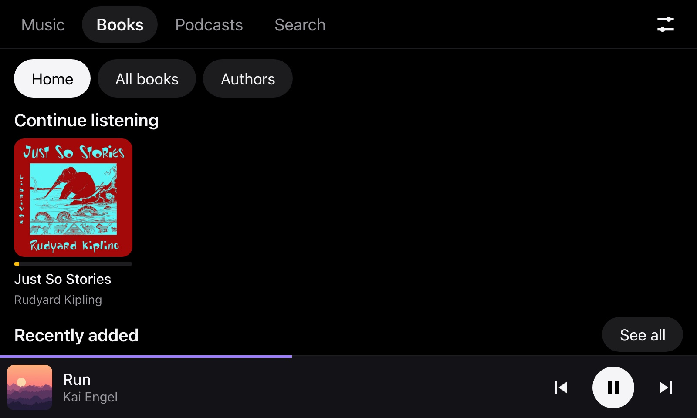
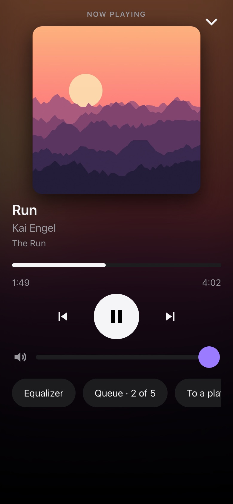

<p align="center">
  
</p>

<h1 align="center">own.audio box</h1>

<p align="center">A Raspberry Pi music, audiobook and podcast player for your own library.</p>

<p align="center">
  <a href="https://www.own.audio">Website</a> ·
  <a href="https://github.com/own-audio/server">Server</a> ·
  <a href="CHANGELOG.md">Changelog</a> ·
  <a href="docs/HARDWARE.md">Hardware</a> ·
  <a href="https://github.com/own-audio/box/issues">Report a problem</a>
</p>

<p align="center">
  
  
</p>
<p align="center">
  
  
</p>
<p align="center">
  
  
</p>

A Raspberry Pi with a touch screen and a sound output, feeding a speaker. It signs in to
an [own.audio](https://www.own.audio) server — the [open-source
server](https://github.com/own-audio/server) at home or the hosted service — with a QR
code on its screen, and plays music, audiobooks and podcasts from it, keeping listening
positions in step with the phone apps. It also runs without a screen, on a small Pi
with a DAC HAT and buttons, controlled from a phone. And it is an AirPlay 2 receiver
and a Music Assistant player.

The software is `ownbox`, one Rust program that drives mpv and serves the touch UI,
shown full screen by Chromium in a kiosk (cage). Early days: it runs every day on the
two boxes below, but there is no release, image or installer yet.

## What it does today

- **Music:** recently added, favourites, albums (by date or A–Z, jump to a letter),
  artists, playlists, search with an on-screen keyboard; gapless play. Playlists are
  made and changed on the box too: hold a track, or add an album or what is playing.
  Smart playlists, saved in the apps or from presets (a genre station among them), play
  with a fresh draw. Home shows playlists, recently played and recently added albums. Play next, add to the queue,
  play all by an artist, and an iPod-like letter strip for fast scrolling in A–Z
  lists.
- **Audiobooks:** continue listening, all books, authors; resume at the saved second,
  ±30 s, speed per book, sleep timer, positions saved to the server.
- **Podcasts:** continue listening, shows with unplayed counts, new episodes, mark as
  played; the same controls as books.
- **Box:** sign-in with a QR code, Czech and English, Wi-Fi from the screen, brightness
  and screen-off, volume, queue, a server-down notice; the queue and position survive a
  restart. A first-run wizard, and the same equalizer as the own.audio Music apps.
  Dark or light, or as each device is set (Settings → Appearance). Buttons with text or
  icons only (Settings → Buttons).
- **Phone control:** any phone on the same network opens `http://ownbox.local:8686/`
  after pairing with a QR code from Settings → Phone control, and gets the library
  and the player. Unpaired devices get nothing but the pairing page; the box's own
  settings stay on its screen.
- **Other sources:** the box is an AirPlay 2 receiver ("own.audio box") and a
  Squeezelite player for Music Assistant; while one of them plays, ownbox lets the sound
  card go and shows what plays, and playing own.audio takes it back. AirPlay needs
  `setup/airplay/build.sh` run once on the Pi.
- **Sound output:** Settings lists the cards found (an I²S DAC, USB, HDMI, the jack).
- **Updates:** signed releases from GitHub, installed from Settings with an automatic
  way back; built and tested, off until the first release.

## Tested on

| | The box with a screen | The radio, no screen |
|---|---|---|
| Board | Raspberry Pi 3 Model B+ (1 GB) | Raspberry Pi Zero 2 W (512 MB) |
| Screen | Official 7" touch display, 800 × 480 | none; a phone is the screen |
| Sound | Jabra SPEAK 410 (USB) | Pimoroni pHAT BEAT (I²S DAC), its five buttons as media keys — sold together with the Zero as the Pimoroni Pirate Radio |
| System | Raspberry Pi OS Lite 64-bit (Debian 13 Trixie), mpv 0.40, Chromium 156 in cage | the same Lite image, no browser |
| Also played to it | AirPlay 2 from an iPhone (shairport-sync 4.3.7), also to both boxes at once | AirPlay 2, and Music Assistant through Squeezelite |

Known: Music Assistant playing to the boxes over AirPlay arrives garbled (its AirPlay 2
and shairport-sync disagree); use its Squeezelite players, or set the player to AirPlay 1
(RAOP) in Music Assistant.

Phones: Safari on iPhone, as the remote control. Servers: the open-source own.audio
server (1.0) and the hosted service. The Pi 3 runs the kiosk and the player in about
420 MB with the CPU capped at 800 MHz.

Meant to work, not yet tested on hardware:

| | |
|---|---|
| Board | Raspberry Pi 4 (a build with Touch Display 2 and the DAC+ is being put together: [docs/HARDWARE.md](docs/HARDWARE.md)) |
| Screen | Touch Display 2, 7" and 5" (720 × 1280, turned to landscape). No other screens. |
| Sound | Raspberry Pi DAC+; other I²S HATs through their overlay (`audio_hat` in `config.toml`) |

## Setting one up

There is no ready image or installer yet; today a box is set up from a Mac (or any
machine with Rust, [zig](https://ziglang.org) and
[cargo-zigbuild](https://github.com/rust-cross/cargo-zigbuild)) over SSH.

1. Write Raspberry Pi OS Lite (64-bit) to a card, with Raspberry Pi Imager (set the
   user, SSH key and Wi-Fi there) or with `scripts/flash-sd.sh` and a `user-data` like
   [setup/user-data](setup/user-data) on its boot partition.
2. Boot the Pi, make sure `ssh <host>` works without a password, then:

```bash
rustup target add aarch64-unknown-linux-gnu
cargo test
scripts/deploy.sh <host>          # build for aarch64 and install on the Pi
setup/install-kiosk.sh <host>     # once, on a box with a screen
ssh <host> journalctl -u ownbox -f
```

ownbox runs as the user you log in as. The screen then shows the first-run wizard:
language, Wi-Fi, the own.audio server, sign-in with a QR code, the sound output.

`deploy.sh` cross-compiles with `cargo zigbuild`, installs ownbox, its systemd units, the
kiosk, the polkit rules (Wi-Fi, the outside sources), the journal cap and the Wi-Fi
country (`WIFI_COUNTRY`, CZ when not given). `setup/boot-config.sh` then writes
what depends on the build: a marked block at the end of `config.txt` (power button,
Bluetooth off, an audio HAT's overlay), the CPU cap for the board and the kiosk's scale
for the panel. An I²S HAT without an EEPROM is named in `config.toml`:

```toml
audio_hat = "hifiberry-dacplus"   # an overlay in /boot/firmware/overlays; takes effect at the next boot
```
 Settings live in
`~/.config/ownbox/config.toml` (written with defaults on first start) and what is changed
on the screen in `~/.local/state/ownbox/` (`prefs.json`, `session.json`, `queue.json`).

## A box without a screen (the radio)

A Pirate Radio (Pi Zero 2 W + pHAT BEAT) runs the same `ownbox` without the kiosk. One
card is enough: flash Raspberry Pi OS Lite (no customisation in Imager), then

```bash
WIFI_SSID=… WIFI_PASSWORD=… scripts/prepare-sd.sh   # writes onto /Volumes/bootfs
```

puts the Wi-Fi, your SSH key (`SSH_KEY_FILE`, `~/.ssh/id_ed25519.pub` by default), ownbox
and `setup/radio/` on the boot partition; the script lists its other options (user,
Wi-Fi country, time zone, server). On first
boot cloud-init runs `firstboot.sh`: it installs mpv, ownbox and its units, writes the
`config.txt` block (the pHAT BEAT's DAC, its five buttons as media keys, on/off as
shutdown) and reboots — about ten minutes on a Zero 2 W, logged in
`/var/log/ownbox-firstboot.log`. Then open `http://ownbox-radio.local:8686/` on a phone.

With `headless = true` in `config.toml` the first phone to open the box pairs without a
code and runs the setup wizard; paired phones may change the box's settings, as the
screen would. Further phones pair with a code from Settings → Phone control on a
phone already paired. Media keys from any input device (the HAT's buttons, a USB
keyboard, the Jabra's volume buttons) control playback on every box.

## Power button

One momentary button shuts the Pi down and starts it again
(`dtoverlay=gpio-shutdown`, GPIO3):

| Physical pin | Signal |
|---|---|
| **5** | GPIO3 (SCL1) |
| **6** (or 9, 14, 20, 25, 30, 34, 39) | GND |

Pin 1 is the square pad at the end of the header nearest the SD card; odd pins on the
inner row, even on the outer edge. Picture:
[docs/power-button-pins.svg](docs/power-button-pins.svg). If the display takes power from
the header (pins 4 and 6), use pin 9 for the button's ground.

With an I²S DAC HAT such as the DAC+, GPIO3 is its I²C clock: shutdown then moves to
GPIO17 (pin 11) with wake kept on GPIO3 — see HARDWARE.md.

## Layout

- `src/` — `ownbox`: config, sign-in, the own.audio API (music, books, podcasts), the
  play queue around mpv, screen, Wi-Fi, prefs, the equalizer, hardware detection,
  outside sources, phone pairing, hardware buttons, the web server
- `ui/` — the touch UI (HTML, CSS, JS, Czech words in `i18n.js`), built into the binary
- `setup/` — systemd units, kiosk, polkit rules, journal settings, `boot-config.sh`,
  the AirPlay build and `apply-sources.sh`, cloud-init template, the blank cursor;
  `setup/radio/` — the radio's first-boot installer, config and cloud-init template
- `scripts/` — `flash-sd.sh`, `prepare-sd.sh` (the radio's card), `deploy.sh`, `ui-check.cjs` (drives the UI headless
  through an SSH tunnel)
- `docs/` — hardware, the power-button picture, the README's pictures

## Versions

[Semantic versioning](https://semver.org), 0.x until the box is one people can buy the
parts for and set up without a Mac. Each release is a tag `vX.Y.Z`: GitHub Actions
builds ownbox for the Pi, signs it with minisign and publishes it as a GitHub Release
([.github/workflows/release.yml](.github/workflows/release.yml)), with that version's
section of the [changelog](CHANGELOG.md) as its notes. Boxes offer the update in
Settings → Updates and put the previous version back if the new one does not start.
Settings shows the running version.

Where it is going: an install script for Raspberry Pi OS, then a ready SD card image
for Raspberry Pi Imager.

## Licence

[MPL-2.0](LICENSE), as the own.audio apps.

The screenshots show the own.audio demo library: music by Kai Engel, Kevin MacLeod and
others under Creative Commons (CC BY 3.0 and 4.0), LibriVox recordings in the public
domain, and covers drawn for the demo.
