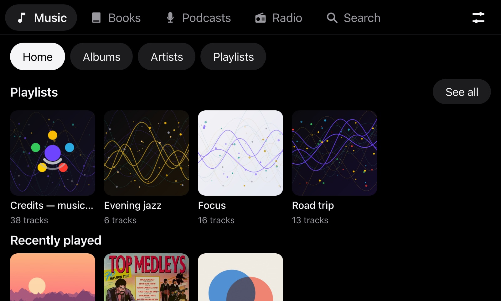
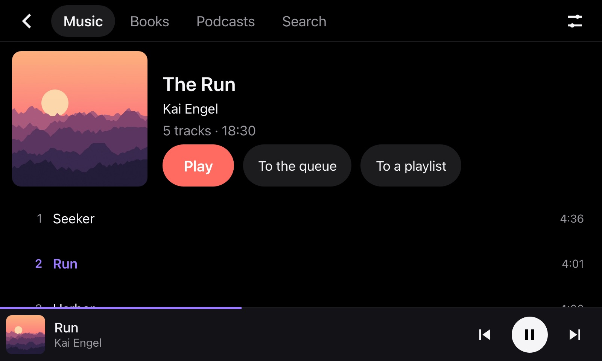
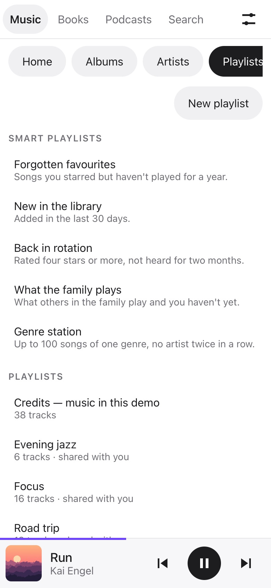

<p align="center">
  
</p>

<h1 align="center">own.audio box</h1>

<p align="center">A Raspberry Pi music, audiobook and podcast player for your own library.</p>

<p align="center">
  <a href="https://www.own.audio">Website</a> ·
  <a href="https://github.com/own-audio/server">Server</a> ·
  <a href="CHANGELOG.md">Changelog</a> ·
  <a href="docs/HARDWARE.md">Hardware</a> ·
  <a href="https://github.com/own-audio/box/issues">Report a problem</a>
</p>

<p align="center">
  
  
</p>
<p align="center">
  
  
</p>
<p align="center">
  
  
</p>

A Raspberry Pi with a touch screen and a sound output, feeding a speaker. It signs in to
an [own.audio](https://www.own.audio) server — the [open-source
server](https://github.com/own-audio/server) at home or the hosted service — with a QR
code on its screen, and plays music, audiobooks and podcasts from it, keeping listening
positions in step with the phone apps. It also runs without a screen, on a small Pi
with a DAC HAT and buttons, controlled from a phone. And it is an AirPlay 2 receiver
and a Music Assistant player.

The software is `ownbox`, one Rust program that drives mpv and serves the touch UI,
shown full screen by Chromium in a kiosk (cage). In beta: it runs every day on the two
boxes below, and installs from an SD card image.

## What it does today

- **Music:** recently added, favourites, albums (by date or A–Z, jump to a letter),
  artists, playlists, search with an on-screen keyboard; gapless play. Playlists are
  made and changed on the box too: hold a track, or add an album or what is playing.
  Smart playlists, saved in the apps or from presets (a genre station among them), play
  with a fresh draw. Home shows playlists, recently played and recently added albums. Play next, add to the queue,
  play all by an artist, and an iPod-like letter strip for fast scrolling in A–Z
  lists.
- **Audiobooks:** continue listening, all books, authors; resume at the saved second,
  ±30 s, speed per book, sleep timer, positions saved to the server.
- **Podcasts:** continue listening, shows with unplayed counts, new episodes, mark as
  played; the same controls as books.
- **Box:** sign-in with a QR code, Czech and English, Wi-Fi from the screen, brightness
  and screen-off, volume, queue, a server-down notice; the queue and position survive a
  restart. A first-run wizard, and the same equalizer as the own.audio Music apps.
  Dark or light, or as each device is set (Settings → Appearance). Buttons with text or
  icons only (Settings → Buttons).
- **Phone control:** any phone on the same network opens `http://ownbox.local:8686/`
  after pairing with a QR code from Settings → Phone control, and gets the library
  and the player. Unpaired devices get nothing but the pairing page; the box's own
  settings stay on its screen.
- **Other sources:** the box is an AirPlay 2 receiver ("own.audio box") and a
  Squeezelite player for Music Assistant; while one of them plays, ownbox lets the sound
  card go and shows what plays, and playing own.audio takes it back. AirPlay needs
  `setup/airplay/build.sh` run once on the Pi.
- **Radio:** stations from radio-browser.info's open directory, searched on the box (any
  country), favourites on the home screen.
- **Sound output:** Settings lists the cards found (an I²S DAC, USB, HDMI, the jack).
- **Updates:** signed releases from this repository, betas included, installed by
  themselves between 3 and 5 at night when nothing plays (or only from Settings, if you
  choose so), with an automatic way back; Debian's security updates once a week on such a
  night.

## Tested on

| | The box with a screen | The radio, no screen |
|---|---|---|
| Board | Raspberry Pi 3 Model B+ (1 GB) | Raspberry Pi Zero 2 W (512 MB) |
| Screen | Official 7" touch display, 800 × 480 | none; a phone is the screen |
| Sound | Jabra SPEAK 410 (USB) | Pimoroni pHAT BEAT (I²S DAC), its five buttons as media keys — sold together with the Zero as the Pimoroni Pirate Radio |
| System | Raspberry Pi OS Lite 64-bit (Debian 13 Trixie), mpv 0.40, Chromium 156 in cage | the same Lite image, no browser |
| Also played to it | AirPlay 2 from an iPhone (shairport-sync 4.3.7), also to both boxes at once | AirPlay 2, and Music Assistant through Squeezelite |

Known: Music Assistant playing to the boxes over AirPlay arrives garbled (its AirPlay 2
and shairport-sync disagree); use its Squeezelite players, or set the player to AirPlay 1
(RAOP) in Music Assistant.

Phones: Safari on iPhone, as the remote control. Servers: the open-source own.audio
server (1.0) and the hosted service. The Pi 3 runs the kiosk and the player in about
420 MB with the CPU capped at 800 MHz.

The real box, tested since 1.0.0-beta.7 (2026-11-18), written from the SD image and
updated through Settings since:

| | |
|---|---|
| Board | Raspberry Pi 4 Model B (Rev 1.5) — parts and assembly in [docs/HARDWARE.md](docs/HARDWARE.md) |
| Screen | Touch Display 2, 7" (720 × 1280), used upright: the page zoomed 1.55 times |
| Sound | Raspberry Pi DAC+ |

Meant to work, not yet tested: the 5" Touch Display 2, the display turned to landscape,
and I²S HATs other than those above (through their overlay, `audio_hat` in
`config.toml`).

**64-bit only.** The box runs on 64-bit Raspberry Pi OS (arm64) and is built for it
alone: Raspberry Pi Zero 2 W, 3, 4 and 5. Boards that can only run 32-bit — the first
Pi Zero and Zero W (also in older Pirate Radio kits), Pi 1 and Pi 2 — are not supported
and will not be; they are too slow for the box anyway. A 32-bit Raspberry Pi OS on a
64-bit board does not work either: use the 64-bit image.

## Install

1. Download `own-audio-box-…-arm64.img.xz` from the
   [latest release](https://github.com/own-audio/box/releases).
2. In [Raspberry Pi Imager](https://www.raspberrypi.com/software/): your board, then
   **Use custom** and the downloaded file, then the SD card (8 GB or more). Imager does
   not offer its settings (Wi-Fi, user, SSH) for a custom file yet; none are needed.
3. Put the card in and switch on. The first start writes the settings for the board and
   restarts once; give it two minutes.

**With a screen**, the wizard shows on it: language, Wi-Fi (or a cable), the own.audio
server, sign-in with a QR code, sound, the box's name.

**Without a screen**, the box opens its own Wi-Fi, named "own.audio box", when it has no
network after a minute. Join it with a phone or a laptop: the setup page opens by itself
(or open `http://10.42.0.1`). Choose your Wi-Fi and its password, the box's name and the
sound card on its pins (the pHAT BEAT of a Pirate Radio, a DAC HAT; none for USB or HDMI),
and the box joins your network. Then, back on your own Wi-Fi, open
`http://<name>.local` — the page says which — and the first phone there runs the same
wizard as the screen and becomes the box's screen. Further phones pair with a QR code
from Settings → Phone control on one already paired.

### Wi-Fi

**The setup Wi-Fi has no password, on purpose.** The Zero 2 W's Wi-Fi chip cannot send a
WPA3 network (it refuses to start one), and its Enhanced Open network ends up unencrypted;
a WPA2 password printed in this README would let anyone in anyway. What protects the box
instead: the setup Wi-Fi opens only when the box has had no network for a while — a
minute on a new box, five minutes on one that knows a network, so a router restarting does
not open it — and closes as soon as one is back, and over it a box can only be given a
network, a name and a sound card. A phone never pairs over it — pairing happens on your own
network.

**Your own Wi-Fi** should be WPA2 on 2.4 GHz. The Zero 2 W cannot join a WPA2/WPA3 network
on a MikroTik ax access point (tried on a hAP ax² under CAPsMAN: refused every time, while
the same access point's WPA2-only network took it at once), so give 2.4 GHz a WPA2-only
security profile there, and 20 MHz channels (at 40 MHz the same access points refused the
radio after some of its restarts); 5 GHz can stay WPA2/WPA3. Other routers' WPA2/WPA3
networks have not been tried. The Zero 2 W and the Pi 3 B know 2.4 GHz only. When several
access points send the same network name (a mesh, or an old router next to a new one), the
box looks half a minute after it starts and every two minutes after that, and moves to one
that is clearly stronger than the one it is on; one that refuses it is tried again ten
minutes later. The Wi-Fi chip's own roaming is off — it kept moving to such an access point
and dropped the network every few seconds.

**On the home screen.** In Safari on an iPhone, Share → Add to Home Screen keeps the box
as an app (its own icon, no browser bars); it pairs itself on its first start, within a
day of adding it. On Android the browser menu's Add to Home screen gives a shortcut that
opens in the browser.

The box comes as `ownbox.local` until it is named; then the name is its address ("own.audio
kitchen" → `kitchen.local`). Updates arrive in Settings → Updates.

## Serial console (beta images)

Beta images open a root shell over USB, for a box that never reaches a network. Connect
the Zero 2 W's data port (marked USB, not PWR) — or a Pi 4's USB-C — to a computer; the
box can take its power from it. A Pi 3 has no such port (its one USB controller carries the
Ethernet and all USB ports), so it has no console this way. A minute after power-on a serial port appears:

```bash
screen /dev/cu.usbmodem* 115200    # macOS
screen /dev/ttyACM0 115200         # Linux
```

Press Enter for a `root@ownbox` prompt. `journalctl -u ownbox -b`, `nmcli device` and
`/var/log` are the usual first looks. Releases (a version without `-beta`) leave this out.

## Development

From a Mac (or any machine with Rust, [zig](https://ziglang.org) and
[cargo-zigbuild](https://github.com/rust-cross/cargo-zigbuild)), onto a Pi with Raspberry
Pi OS Lite (64-bit) that `ssh <host>` reaches without a password:

```bash
rustup target add aarch64-unknown-linux-gnu
cargo test
scripts/deploy.sh <host>          # build for aarch64 and install on the Pi
setup/install-kiosk.sh <host>     # once, on a box with a screen
ssh <host> journalctl -u ownbox -f
```

ownbox runs as the user you log in as. `deploy.sh` cross-compiles with `cargo zigbuild`,
installs ownbox, its systemd units, the kiosk, the polkit rules (Wi-Fi, the outside
sources), the journal cap and the Wi-Fi country (`WIFI_COUNTRY`, CZ when not given).
`setup/boot-config.sh` then writes what depends on the build: a marked block at the end
of `config.txt` (power button, Bluetooth off, an audio HAT's overlay), the CPU cap for
the board and the kiosk's scale for the panel. An I²S HAT without an EEPROM is chosen in
Settings → Sound card on the pins, or named in `config.toml`:

```toml
audio_hat = "hifiberry-dacplus"   # an overlay in /boot/firmware/overlays; takes effect at the next boot
```

Settings live in `~/.config/ownbox/config.toml` (written with defaults on first start)
and what is changed on the box in `~/.local/state/ownbox/` (`prefs.json`,
`session.json`, `queue.json`).

The image is built by `setup/image/build.sh` (64-bit ARM Linux, as root; GitHub Actions
runs it as `.github/workflows/image.yml` for every release). `scripts/prepare-sd.sh`
still prepares a bare Raspberry Pi OS card as a Pirate Radio that installs itself on
first boot, for development.

With `headless = true` in `config.toml` (the image sets it at every boot when no screen
is connected) the first phone to open the box pairs without a code and runs the setup
wizard; paired phones may change the box's settings, as the screen would. Media keys
from any input device (the HAT's buttons, a USB keyboard, the Jabra's volume buttons)
control playback on every box.

## Power button

One momentary button shuts the Pi down and starts it again
(`dtoverlay=gpio-shutdown`, GPIO3):

| Physical pin | Signal |
|---|---|
| **5** | GPIO3 (SCL1) |
| **6** (or 9, 14, 20, 25, 30, 34, 39) | GND |

Pin 1 is the square pad at the end of the header nearest the SD card; odd pins on the
inner row, even on the outer edge. Picture:
[docs/power-button-pins.svg](docs/power-button-pins.svg). If the display takes power from
the header (pins 4 and 6), use pin 9 for the button's ground.

With an I²S DAC HAT such as the DAC+, GPIO3 is its I²C clock: shutdown then moves to
GPIO17 (pin 11) with wake kept on GPIO3 — see HARDWARE.md.

## Layout

- `src/` — `ownbox`: config, sign-in, the own.audio API (music, books, podcasts), the
  play queue around mpv, screen, Wi-Fi and the setup Wi-Fi, prefs, the equalizer,
  hardware detection, outside sources, phone pairing, hardware buttons, the web server
- `ui/` — the touch UI (HTML, CSS, JS, Czech words in `i18n.js`), built into the binary
- `setup/` — systemd units, kiosk, polkit rules, journal settings, `boot-config.sh`,
  the AirPlay build and `apply-sources.sh`, cloud-init template, the blank cursor;
  `setup/image/` — the SD card image's build, config and per-boot check;
  `setup/radio/` — a bare card's first-boot installer for the radio (development)
- `scripts/` — `flash-sd.sh`, `prepare-sd.sh` (the radio's card), `deploy.sh`, `ui-check.cjs` (drives the UI headless
  through an SSH tunnel)
- `docs/` — hardware, the power-button picture, the README's pictures

## Versions

[Semantic versioning](https://semver.org). Betas of 1.0.0 for now (`1.0.0-beta.1`,
`beta.2`…); 1.0.0 once people can buy the parts and set a box up without a Mac. Each
release is a tag `vX.Y.Z` (a beta is published as a pre-release): GitHub Actions
builds ownbox for the Pi, signs it with minisign and publishes it as a GitHub Release
([.github/workflows/release.yml](.github/workflows/release.yml)), with that version's
section of the [changelog](CHANGELOG.md) as its notes. Boxes install it at night by
themselves (Settings → Updates can leave it to a tap instead) and put the previous
version back if the new one does not start. The night is the box's local time:
Settings → Time zone, set to Europe/Prague by itself when Czech is chosen on a box still
on the default zone.
Settings shows the running version.

Each release carries the SD card image as well. Next: own.audio box in Raspberry Pi
Imager's own list, so it can be picked there with Imager's settings.

## Licence

[MPL-2.0](LICENSE), as the own.audio apps.

The screenshots show the own.audio demo library: music by Kai Engel, Kevin MacLeod and
others under Creative Commons (CC BY 3.0 and 4.0), LibriVox recordings in the public
domain, and covers drawn for the demo.
